# Thinq

**An organizational knowledge assistant whose answers are current, approved, and safe for the person asking.**

Most "company brains" fail the same way: they search everything and confidently repeat whatever they find, whether that's an unapproved draft, a retired form, or a document the person was never allowed to see. Thinq starts from the opposite end. It knows who owns each document, whether it is approved, and who may see it, and it checks access on every request before anything reaches the AI.

> **Status:** pilot-ready. Access control, the document library, the assistant with cited answers (any AI provider, or none), and an access-controlled knowledge graph are in place.

<p align="center">
  
</p>

## What works today

- **Sign-in:** email and password (Argon2), server-side sessions in HttpOnly cookies, failed-login throttling. An optional demo mode adds one-click sign-in as any user.
- **Access groups:** people get access through groups, never individually. A built-in **Everyone** group covers every active user.
- **Instant access changes:** a user's groups and role are re-read from the database on every request. When an Admin removes someone from a group, it applies to that person's very next request, with no sign-out and no waiting for a sync.
- **Safeguards:** Admins can't demote or deactivate themselves, and the last Admin can't be removed. Deactivating a user ends their sessions immediately.
- **Audit log:** every sign-in and every change to people, roles and groups is recorded with who did it and when.
- **Document library:** documents and a manifest are imported from a folder, re-scanned on every start, and versioned when they change. A person only sees documents shared with one of their groups; everything else returns "not found", including search and version history.
- **Data-quality checks:** unregistered files, near-duplicate copies, missing owners or statuses, owners that are teams, confidential files shared too widely, text aimed at AI assistants, and manifest drift are flagged in an Admin "Needs attention" queue with one-click fixes.
- **Ask Thinq (chat):** answers stream in with numbered citations and source cards showing status, owner and review date. Approved documents outrank drafts, outdated versions are never used, and "I couldn't find it" is a real answer. Conversations are private (Admins included), and an earlier answer is hidden if you lose access to a document it cited. Copy, regenerate, stop, helpful / not helpful with a reason, rename, pin, delete.
- **Any AI provider, or none:** set `THINQ_LLM_MODEL` to any [Pydantic AI](https://ai.pydantic.dev) model (`openai:…`, `anthropic:…`, `google-gla:…`, `groq:…`, `ollama:…`, any OpenAI-compatible endpoint), with optional fallbacks. Leave it empty for preview mode, which answers with the most trusted excerpts. The model only ever receives documents the person asking may see; text aimed at an AI assistant is removed first.
- **Trust and approval:** versions of a document are grouped, and the Approved one is current even when a newer draft exists. Owners and Admins approve, reject, retire or confirm documents, with every change recorded; approving a new version retires the old one in the same step. When an approved document (a memo, say) names another as current or retired, Thinq proposes the change for a person to confirm. Overdue reviews are flagged.
- **Feedback loop:** "not helpful" on an answer, or "report a problem" on a document, reaches the document's owner (or Admins), who resolve it; the person who flagged sees the outcome.
- **Sources and sync:** a folder of Markdown/text files plus a manifest, synced on start, on a schedule and on demand. Edits create versions, renames and moves keep history, deleted files leave answers at once, and a failed sync changes nothing. Admins can also upload documents.
- **Answer quality:** a golden question set runs through the real API as real users (`make eval`, and in CI). Admins get a live quality dashboard and a retrieval inspector that shows what any person's question would use, and why.
- **Knowledge graph:** a page showing how your documents connect: version families, owners, groups, references and, with the optional Cognee layer, the topics they mention. Built per person from what they can access right now.
- **Optional Cognee knowledge layer:** semantic search and entity extraction by [Cognee](https://www.cognee.ai), stored in the same PostgreSQL server. Thinq keeps one dataset per access group and re-checks every result against its own rules, so Cognee never decides who sees what.
- **System status:** a public page with live web, API and database health, plus a streaming check.

## Screenshots

Taken with the sample organization in [`seed/sample`](seed/sample) (Dana in Operations, Sam in Finance, Alex as Admin), a small local model through Ollama, and the optional Cognee layer on. Regenerate them with `make screenshots`.

### 1. Approved beats newer, and every answer shows its source and status

Dana asks for the current travel policy. Thinq answers from the **Approved** v2, says a newer draft isn’t approved yet, leaves out the outdated version, and names its top source with its status.


Sources open only when wanted: each shows its status, who can see it, the owner, the last review and the passage used.

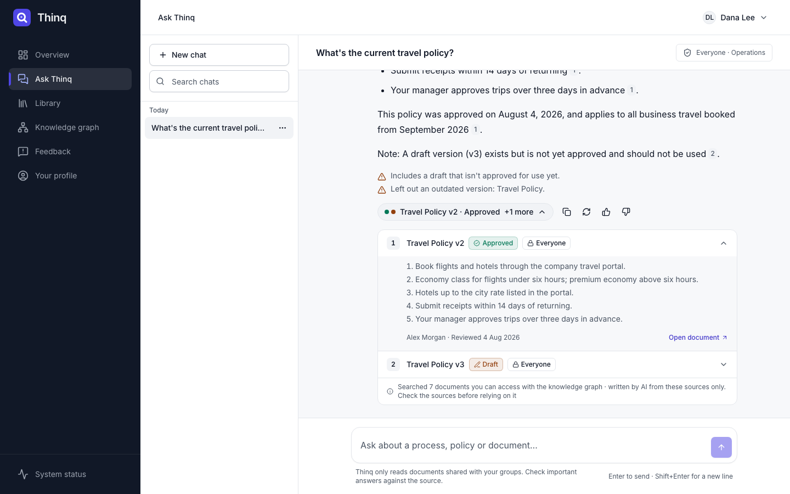

### 2. Access is enforced before anything reaches the AI

Dana (Operations) asks when payroll runs. The Finance-only calendar is never retrieved, so the model never sees it: “I couldn’t find it”, with no source shown.

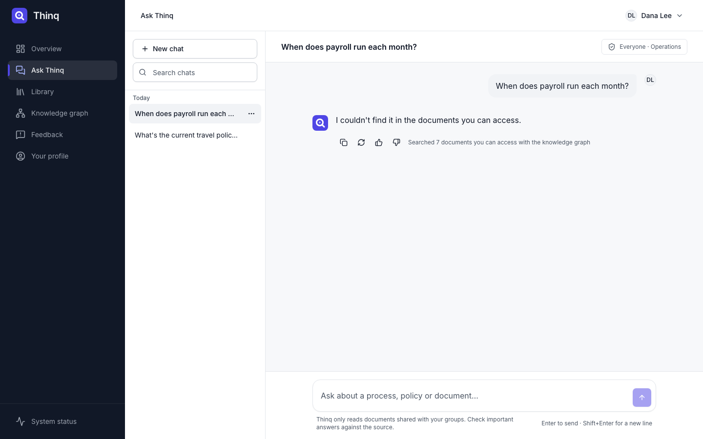

Sam (Finance) asks the same question and gets the answer, cited to the Approved, Finance-only Payroll Calendar.

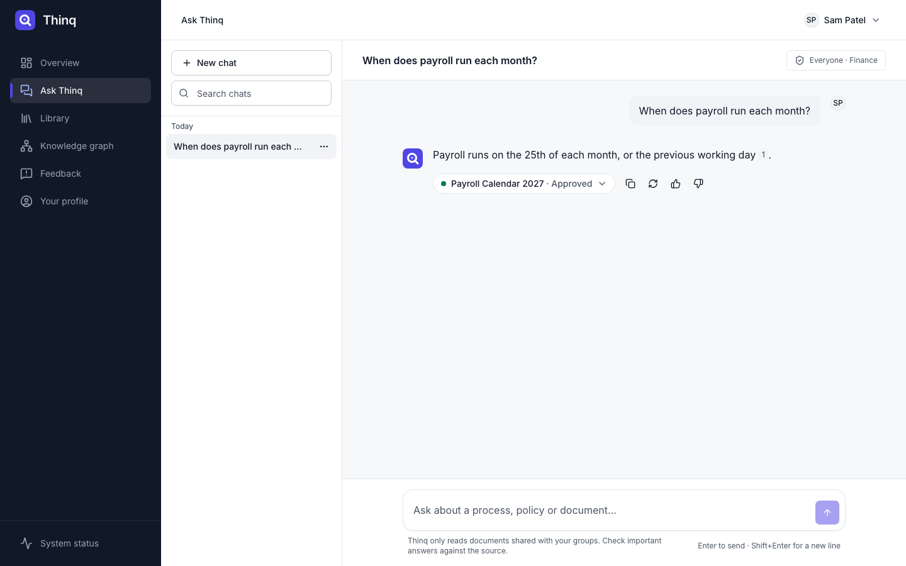

### 3. Removing access applies on the very next question

Alex (Admin) removes Sam from Finance, with undo. It applies to Sam’s very next request: no sign-out, no sync.

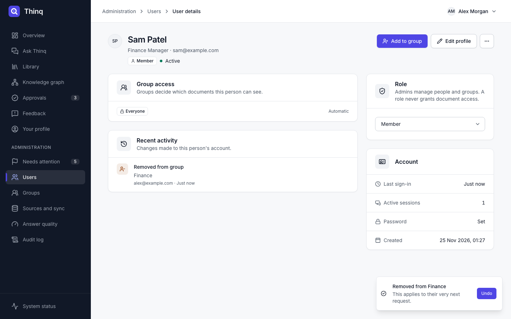

Sam’s earlier Finance answer is hidden, and asking again finds nothing he can access.

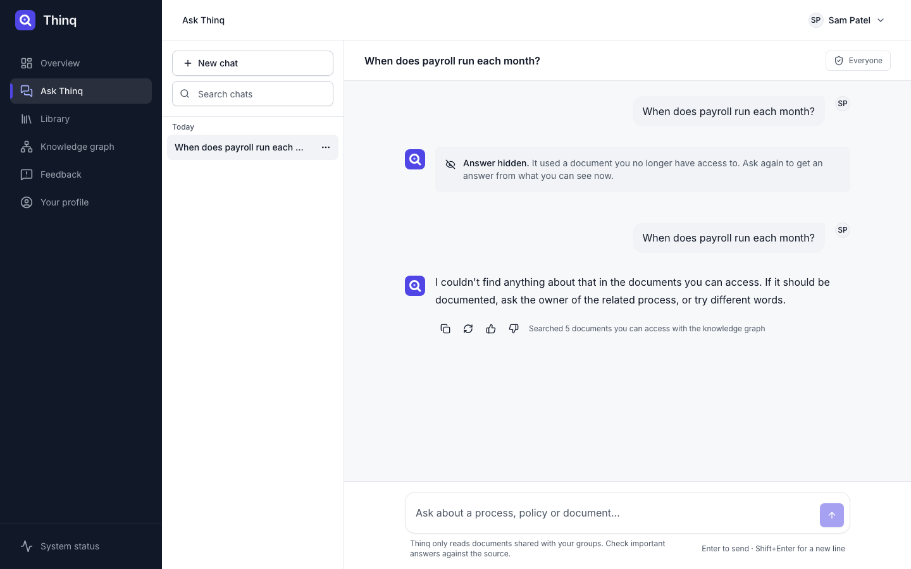

<details>
<summary><strong>More screenshots</strong>: trust and approval, data quality, knowledge graph, feedback, operations, phone</summary>

### Ask, or browse what you can access

Ask Thinq says which groups answers come from, and suggests questions only from documents the person can see.

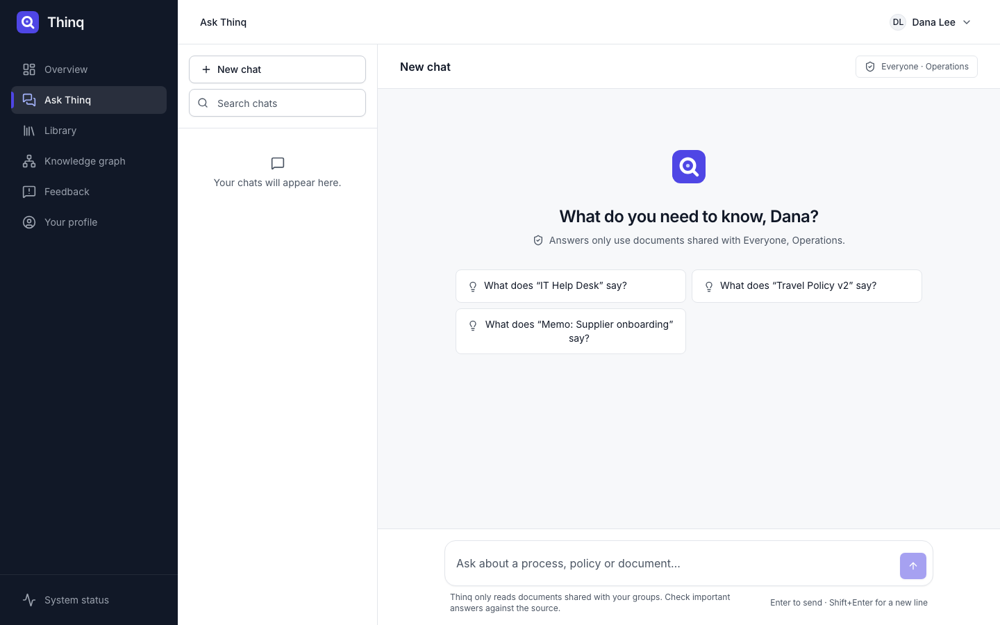

The library lists every document the person may see, with its status, owner, last review and access group.

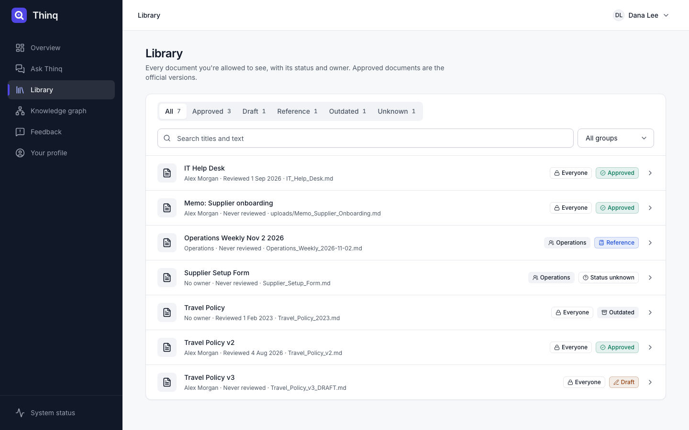

### Trust and approval

Every document shows its status, owner, review dates and audience, and the versions of the same document: the approved one is current even when a draft is newer. Only the owner or an Admin can change status, and every change is recorded.

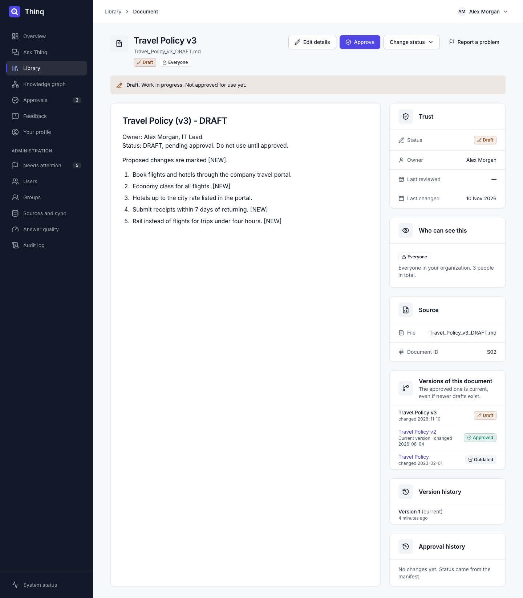

When an approved document (here, a memo) names another as the one to use, Thinq proposes the change and a person confirms. Drafts and documents nobody has given a status wait here too.


### Messy data is flagged, not trusted

A file missing from the manifest, a near-duplicate copy, missing owners and statuses, a team listed as owner, and a planted instruction aimed at AI assistants, each flagged with a fix. Unregistered files are visible to Admins only and never used for answers.

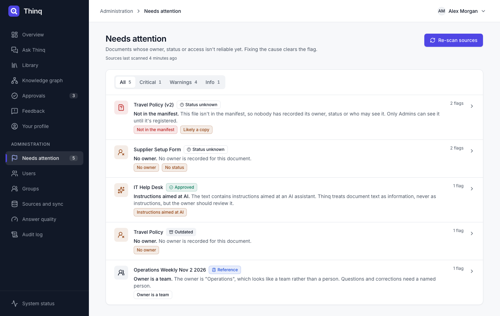

### Knowledge graph

How the documents a person can access connect: versions (oldest to newest), owners, groups and, with Cognee, the topics they mention. Finance documents never appear for Dana.


### Feedback reaches the person who can fix it

“Not helpful” on an answer goes to the owner of the document it cited (or to Admins), with the question, the note and the answer.


The person who flagged it sees what was done about it.

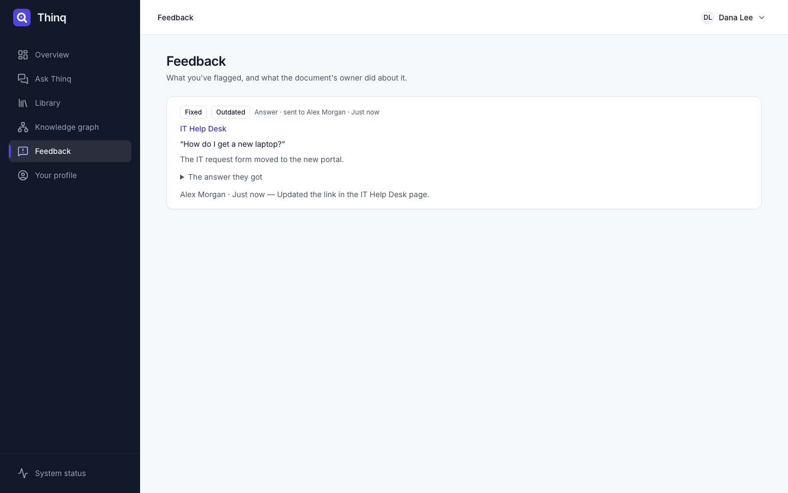

### Operations and quality

A folder plus a manifest, synced on start, on a schedule and on demand. Renames keep history, deleted files leave answers at once, a failed sync changes nothing. Admins can also upload documents.


Live figures from answers and feedback, and a retrieval inspector that shows what any person’s question would use, and why.

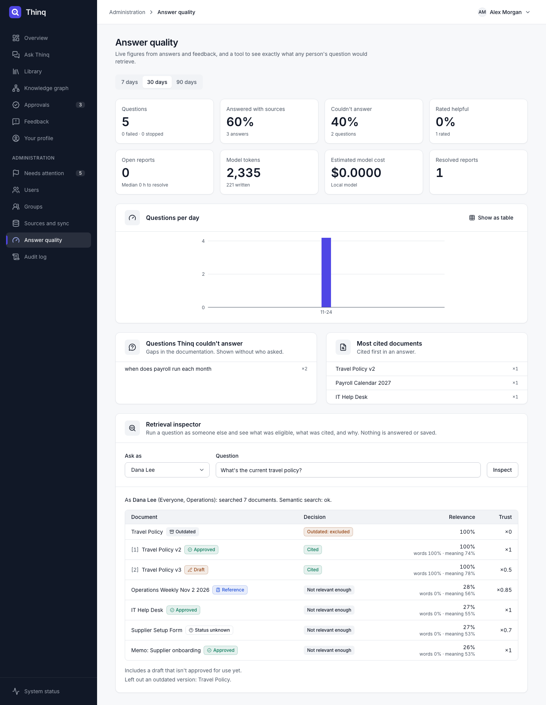

The Admin overview lists settings that are fine for a demo but unsafe for real use.


Sign-ins, access changes, status changes and questions (never their text) are in the audit log.

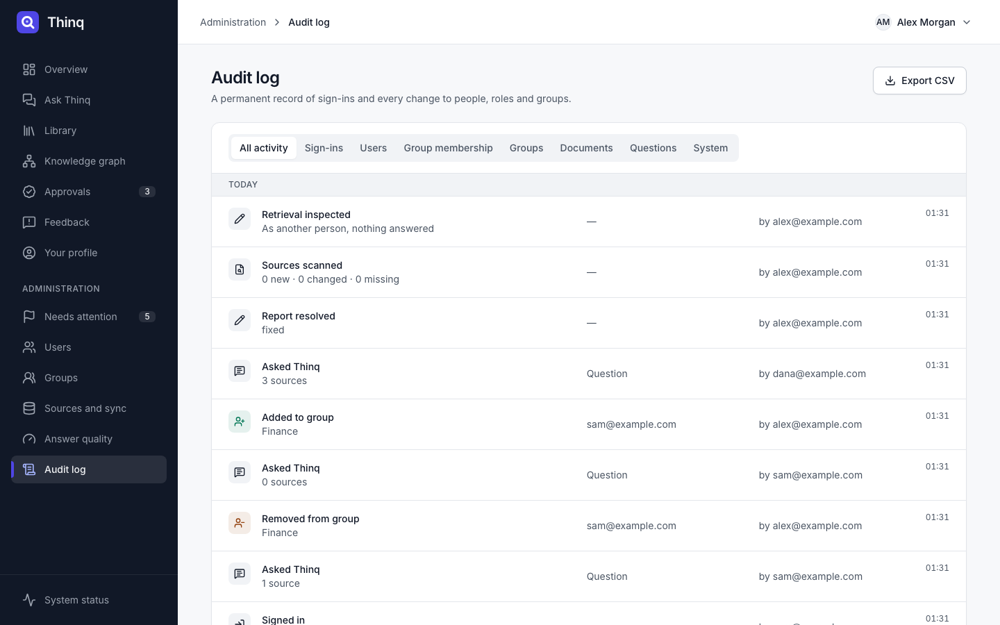

### On a phone

 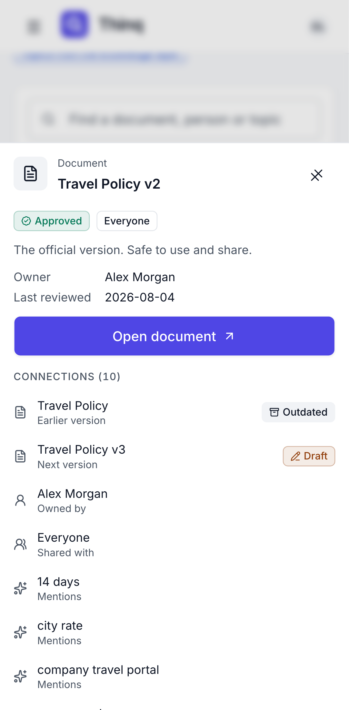

### Before signing in


</details>

## Quick start

You need Docker with Compose v2.22 or later.

```sh
git clone <this repository> thinq && cd thinq
cp .env.example .env
docker compose up -d --build --wait
```

Open <http://localhost:3000>. The sample organization in `seed/sample` is loaded on first start (with no seed folder, the sign-in page offers a one-time setup that creates the first Admin):

| Person      | Role   | Groups              | Password          |
|-------------|--------|---------------------|-------------------|
| Alex Morgan | Admin  | Operations, Finance | `thinq-demo-2026` |
| Dana Lee    | Member | Operations          | `thinq-demo-2026` |
| Sam Patel   | Member | Finance             | `thinq-demo-2026` |

Demo mode is on in `.env.example`, so you can also sign in with one click. **Turn it off (`THINQ_DEMO_MODE=false`) and change the seed password for any real deployment.**

To load your own people and documents, point `THINQ_SEED_PATH` at a folder containing `users.csv`, `manifest.csv` and a `documents/` folder ([format](seed/README.md)).

## Turning on AI answers and the knowledge layer

Both are optional; Thinq works without either.

```sh
# .env — answers from a local model (needs Ollama on this machine), no API key:
THINQ_LLM_MODEL=ollama:qwen3:4b-instruct-2507-q4_K_M
# ...or a hosted one:
# THINQ_LLM_MODEL=anthropic:claude-sonnet-5-5   and   ANTHROPIC_API_KEY=...

# Cognee semantic search + knowledge graph topics (adds the cognee container):
COMPOSE_PROFILES=cognee
THINQ_RETRIEVER=cognee
```

Then `docker compose up -d --build --wait`. Cognee builds its graph in the background (a few minutes for
the sample with a small local model); until then, and whenever Cognee is unavailable, Thinq falls back to
its built-in search. Admins can trigger a sync from the knowledge graph page. Cognee's own LLM is set with
`COGNEE_LLM_*` (see `.env.example`); embeddings run locally.

## Architecture

```
Browser ──► Next.js (web, :3000) ──/api/*──► FastAPI (internal) ──► PostgreSQL 18 + pgvector
                                                 │   └─► AI provider (optional, via Pydantic AI)
                                                 └─────► Cognee (optional) ──► same PostgreSQL, "cognee" database
```

Every question follows one fixed, auditable path: **authorize → retrieve only what this person may see →
rank by trust → generate with citations → verify citations.** The model has no tools, so a document can't
talk it into fetching more.

- **One origin.** The browser only talks to the Next.js server, which forwards `/api/*` to the API over the internal Docker network and streams responses through. There's no CORS, and the session cookie never leaves the site.
- **The backend owns every rule.** Authentication, authorization and auditing live in FastAPI. The web app never decides who can see what.
- **Sessions, not self-contained tokens.** The cookie holds an opaque random token, and only its SHA-256 is stored. A token that carried a user's groups would stay valid after an Admin removed them.

| Layer     | Technology |
|-----------|------------|
| Web       | Next.js 16 (App Router, Turbopack), React 19, TypeScript 6, Tailwind CSS 4, shadcn/ui on Base UI, TanStack Query |
| API       | Python 3.14, FastAPI, SQLAlchemy 2.1 (async), Alembic, psycopg 3, pwdlib (Argon2), structlog |
| AI        | Pydantic AI (any provider), AI SDK UI message stream, Cognee 1.6 (optional) |
| Database  | PostgreSQL 18 with pgvector |
| Tooling   | uv, pnpm, Ruff, mypy (strict), Biome, pytest, Vitest, Playwright |

## Development

```sh
make dev      # hot reload; API on 127.0.0.1:8000, database on 127.0.0.1:55432
make test     # backend tests against real PostgreSQL + frontend unit tests
make test-e2e # browser tests against the full stack
make eval     # golden question set against the running stack
make screenshots # README screenshots (stack running with seed/sample)
make backup   # database dump to backups/
make lint     # Ruff, mypy, Biome, TypeScript
make help     # everything else
```

Running the backend or frontend outside Docker needs [uv](https://docs.astral.sh/uv/) and Node.js 24+ with pnpm 12.

Database changes go through Alembic migrations in `backend/migrations`. They run automatically on start, under a lock, so concurrent starts are safe. After changing the API, run `make api-types` to regenerate the frontend's typed client. CI fails if it is out of date.

Interactive API documentation is served at `/api/docs` in development (`make dev`). In production it's off unless you set `THINQ_API_DOCS=true`.

## Configuration

All settings are environment variables. See [`.env.example`](.env.example) for the common ones and `backend/app/core/config.py` for the full list.

| Variable              | Default          | Purpose |
|-----------------------|------------------|---------|
| `THINQ_PORT`          | `3000`           | Port the web app is published on |
| `THINQ_DEMO_MODE`     | `false`          | One-click sign-in as any user. Never enable in production |
| `THINQ_SEED_PATH`     | `./seed/sample`  | Folder with `users.csv`, loaded once into an empty database |
| `THINQ_SEED_PASSWORD` | *(empty)*        | Initial password for seeded users |
| `THINQ_COOKIE_SECURE` | `false`          | Set to `true` behind HTTPS |
| `POSTGRES_PASSWORD`   | `thinq`          | Database password. Change it for any shared deployment |
| `THINQ_LLM_MODEL`     | *(empty)*        | Pydantic AI `provider:model`. Empty = preview mode |
| `THINQ_RETRIEVER`     | `lexical`        | `cognee` adds Cognee semantic search (with `COMPOSE_PROFILES=cognee`) |
| `COGNEE_PASSWORD`     | `thinq-cognee`   | Password of Cognee's service account. Change it for any shared deployment |

## More

- [ARCHITECTURE.md](ARCHITECTURE.md): how the pieces fit and where each rule lives
- [OPERATIONS.md](OPERATIONS.md): settings for real use, backups, monitoring, cost, limits
- [SECURITY.md](SECURITY.md): reporting vulnerabilities and how data is protected
- [CONTRIBUTING.md](CONTRIBUTING.md): ground rules and development setup

## License

[Apache License 2.0](LICENSE). Illustrations on the public pages are [Open Doodles](https://www.opendoodles.com) by Pablo Stanley, CC0.
